<!-- blog-sync: commit=dec650d64e0590ea9f43cfe403781edd1011eba6 screenshots="pnpm screenshots" updates=updates -->

# 一支業餘棒球隊的官方網站

這是一個社區棒球隊的官方網站：前台給球員、家屬和對手看賽程、戰績、球員與公告，
後台給一個人（通常是管理球隊的那位）維護全部內容。它跑在 Nuxt 4 上，資料在
Firebase，幾支 AI 辨識端點負責把「球場上已經存在的紙本與圖片」變成資料。

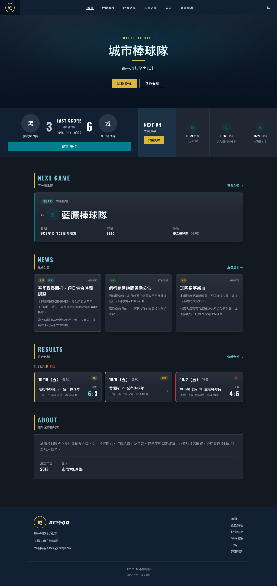

它看起來像一個普通的球隊網站，但大部分的設計決定都不是為了「看起來像」——
而是為了讓**一個人在星期天早上九點、站在場邊、一隻手拿著手機**的時候，
這個網站還能用。下面大半篇幅講的是那些決定，以及它們各自擋住了什麼。

---

## 一條貫穿全站的規則：前端不認識 Firebase

```
瀏覽器 → app/（Vue 3，只認得 /api/*）
        → server/（Nitro BFF，唯一持有憑證的地方）
        → Firestore / Storage / Gemini / Identity Toolkit
```

前端完全不載入 Firebase SDK，也拿不到任何 token。後台登入是 BFF 在伺服器端向
Identity Toolkit 驗證帳密，再改發自己的 httpOnly 加密 session —— 就算發生 XSS，
攻擊者也偷不走任何憑證。

這條規則往下延伸成四條分層紀律，整個專案都照它走：

| 紀律                       | 意思                                                      |
| -------------------------- | --------------------------------------------------------- |
| 頁面不寫 API 路徑          | 一律經過 `app/composables/api/` 的領域 composable         |
| 端點不直接碰 Firestore     | 一律經過 `server/repositories/`，換資料來源只改那個資料夾 |
| 型別與驗證只寫一份         | `shared/schemas/`，後端執行期驗證、前端 `z.infer` 取型別  |
| 寫入端點先 `requireUser()` | 路由 middleware 只是體驗，真正的檢查在 BFF                |

另外有一個刻意的例外：限期的「預測世界大賽冠軍」活動讓瀏覽器直接讀寫一個**獨立的**
Realtime Database。理由是「要真的即時」「資料要跟正式資料完全分家」「沒有前台登入
系統，走 BFF 也只能無條件放行」—— 三個理由缺一個都不會這樣做，而且它只違反這一條。

### 沒有憑證也跑得起來

專案 clone 下來 `pnpm dev` 就有完整畫面：沒有 Firebase 設定時 repository 會改用
記憶體裡的示範資料，後台用任何 email 配一個萬用密碼就能登入。端對端測試因此不需要
Firestore emulator，這篇文章裡的每一張截圖也是這樣拍的。

反過來，**production 缺少設定會在啟動時直接拒絕啟動**，不會悄悄跑在示範資料上 ——
「跑起來了但其實是假資料」是那種可以撐三個月才被發現的錯誤。

---

## 前台：給球員與家屬看的

賽程、戰績、球員名冊、公告，加上單場比賽頁。

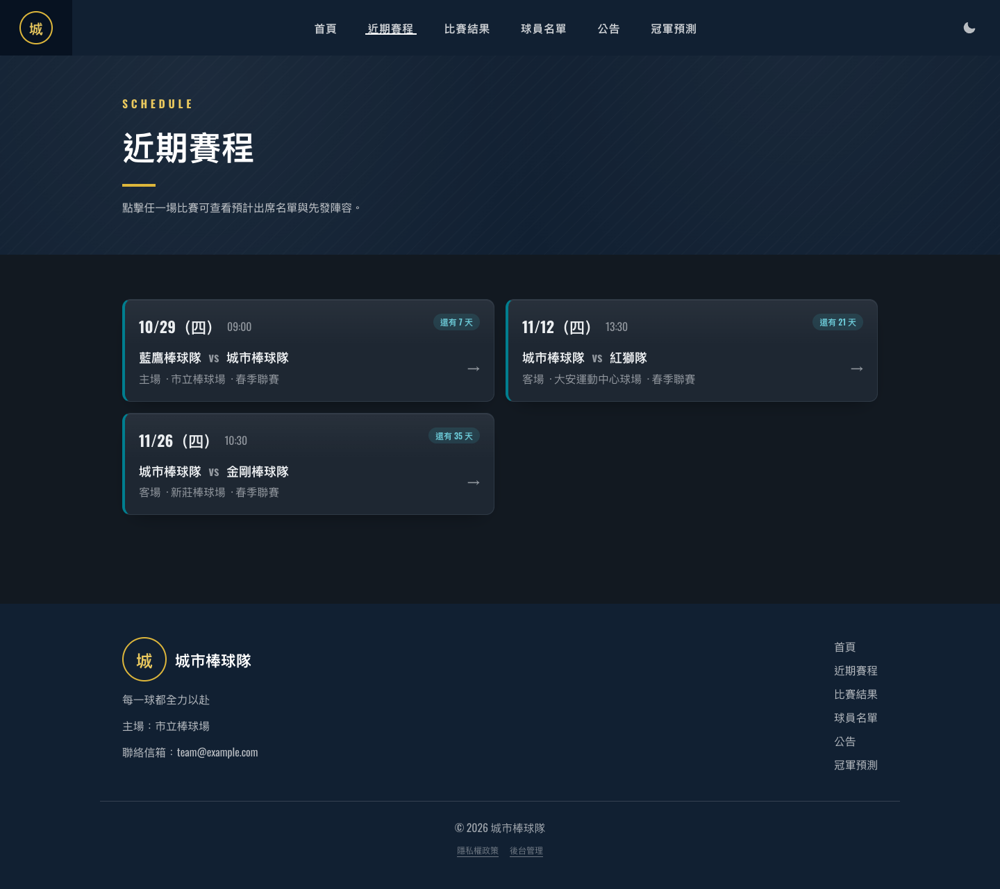

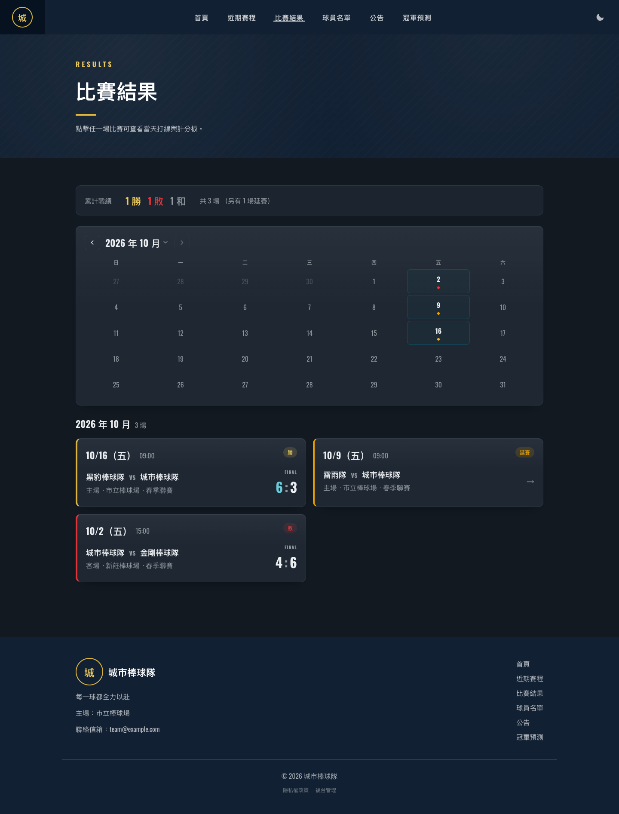

球員名冊與個人頁。打線與出席存的是**姓名快照**，所以球員改名不影響歷史紀錄。

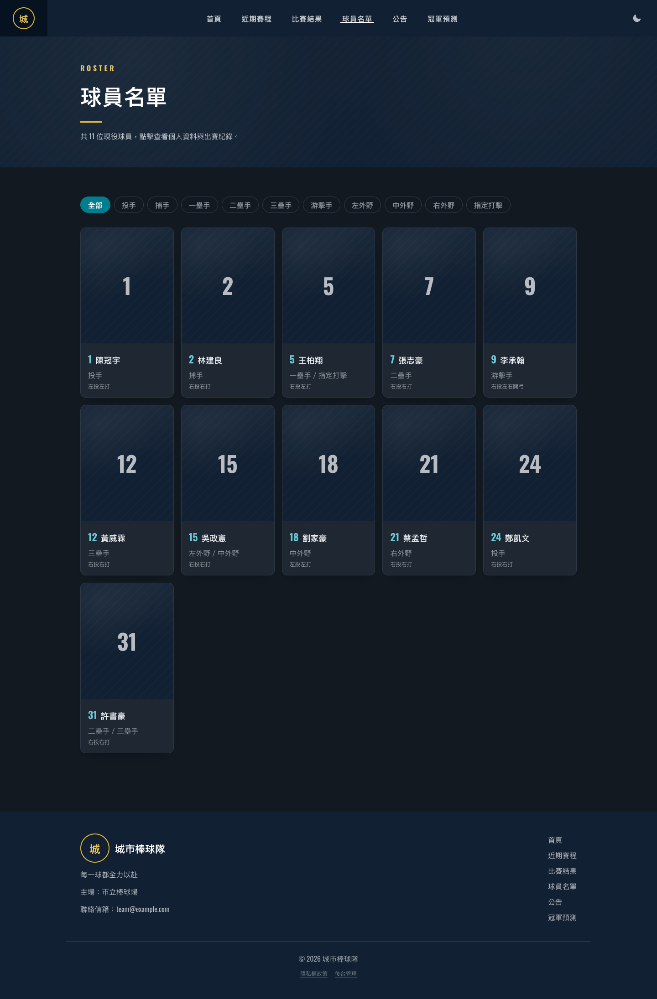

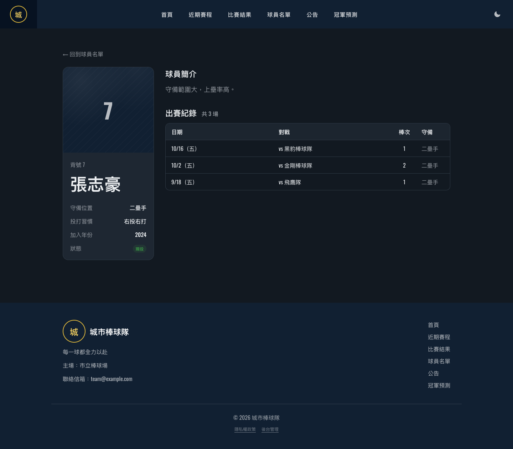

個人頁上的「出賽紀錄」有兩個很容易算錯的地方。一是**延賽與取消的場次要排掉**：
那些比賽也列在過去的比賽裡，而打線是賽前排的，所以延賽那一場照樣有他的名字，
不排掉的話「共 12 場」裡會混著幾場根本沒打的。二是**「這場有沒有他」不能只比對
打線** —— DH 制下的先發投手整場都不會出現在打線上，他投了七局，個人頁卻說那天
沒有他的紀錄；中繼、終結與代打同理。

公告存的是 Markdown 原始碼而不是 HTML（存 HTML 等於把一堆可執行的標記放進資料庫），
安全性靠「解析器不會產生危險的 HTML」而不是事後清洗。

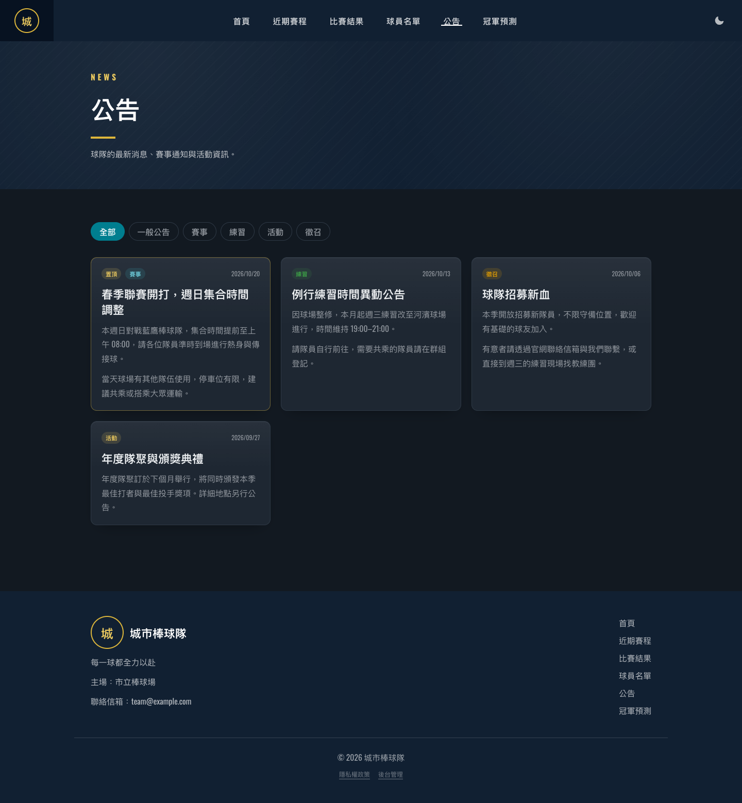

單場比賽頁是前台的重心，一頁之內有計分板、成績表、擊球落點、逐局戰況與錄影片段。

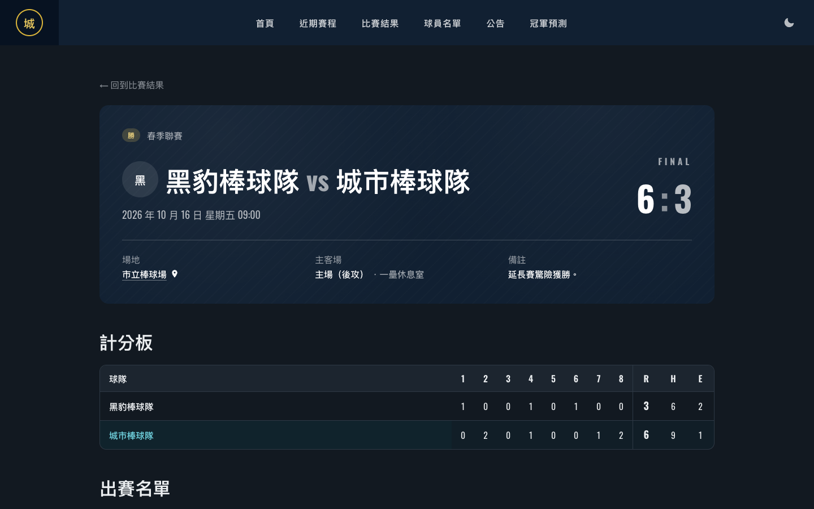

幾個在這一頁反覆出現的原則：

**能推導的就不存。** 勝敗沒有欄位，由「狀態 + 計分板總分」算出來，而且只有
`finished` 的比賽才有值。曾經有一個「比賽結果」下拉選單可以手動覆寫，實際發生的事
是：改完計分板忘了回頭改它，前台就出現「6:3」配上一個「敗」。同樣的道理，R（總得分）
一律是逐局加總、候補名單由出席與打線推導、坐哪一側的休息室由先攻後攻推導
（大會規定先攻坐三壘側）—— 每多存一份，就多一個會不同步的東西。

**不確定就不要顯示。** 成績表只在逐打席登錄完整時才顯示打擊率；box score 刻意沒有
個人得分（R），因為要知道誰跑回本壘就得記每個跑者的推進，那是專業記錄軟體的工作量。
誠實地少一欄，好過憑空生一個會被當真的數字。

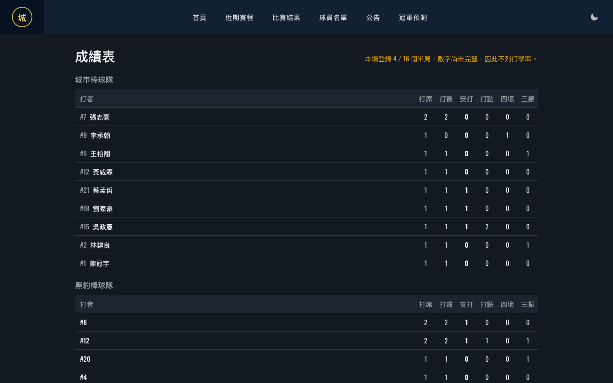

### 擊球落點

每一個在球場上登錄的打席都帶著一個落點，前台把它們畫成一張圖，可以分兩隊看、
也可以只看某一位打者。

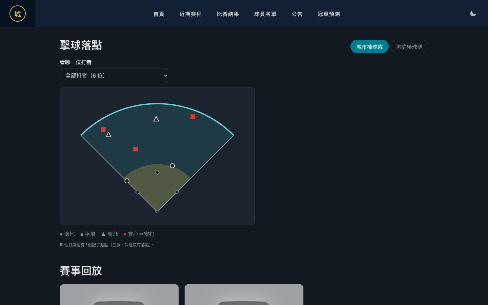

圖上刻意寫出「N 個打席裡有 M 個記了落點」—— 少了這句，一張只登了五個落點的圖
看起來就像那一場只打了五球。選了單一打者時還會補一句「單場的點數本來就少」：
一位打者一場只有三四個打席，三個點的圖不足以排守備站位，不講的話它會被當成
那個人的打擊傾向。

### 出席由隊員自己回報

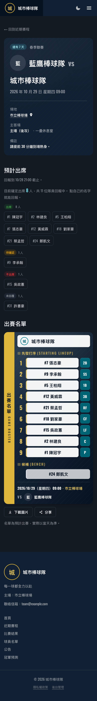

點自己的名字、再點答案。**沒有前台登入系統，所以誰都能改誰的** —— 這是刻意的：
靠瀏覽器記「我是誰」會在換手機、清資料、無痕視窗之後失效，變成「明明是我卻改不了」，
那比誰都能改更糟。前台防的是手滑（兩段式，第二步把名字寫出來），真的被亂改時
後台隨時改得回來。

防線不在身分，在**把能做的事壓到很小**：只能改已經在名單上的那個人的狀態，
不能新增人、不能改姓名背號、只收三個列舉值（不收自由文字，因為自由文字會顯示在
公開頁面上），而且「未回覆」不是一個可以選的答案 —— 它是一個狀態的缺席。

鎖盤有兩條線，取先到的那一條：**比賽開打就鎖**（開打之後那份名單就是歷史紀錄了），
以及後台可以另外設一個更早的截止時間（教練要照名單排打線、訂便當）。
前台、後台與端點共用同一支判斷函式 —— 各寫一次的話，遲早會出現「畫面上按得下去、
按了卻失敗」。

---

## 後台：給一個人管的

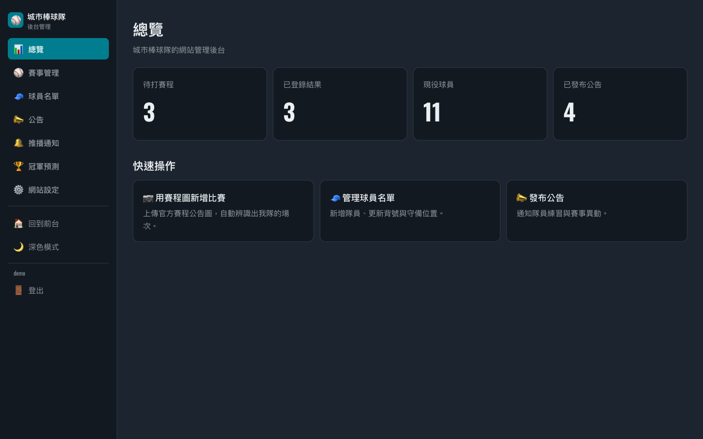

後台的編輯畫面**沒有儲存按鈕**。出席登記這種「點十幾下、每下都是一個獨立決定」的
操作，按鈕只是多一個會忘記的步驟。代價是「以為存好了，其實沒有」變成最危險的
失敗模式，所以狀態必須看得見 —— 用固定在畫面角落的提示，而不是釘在表單上方的一行字
（後台的單場賽事頁很長，使用者在填計分板時根本看不到頁首，而那正是最想確認
「到底存進去了沒有」的時候）。

單場賽事分成五個分頁，各自只送自己那一組欄位，所以編輯打線不會覆蓋別人剛更新的
出席名單。

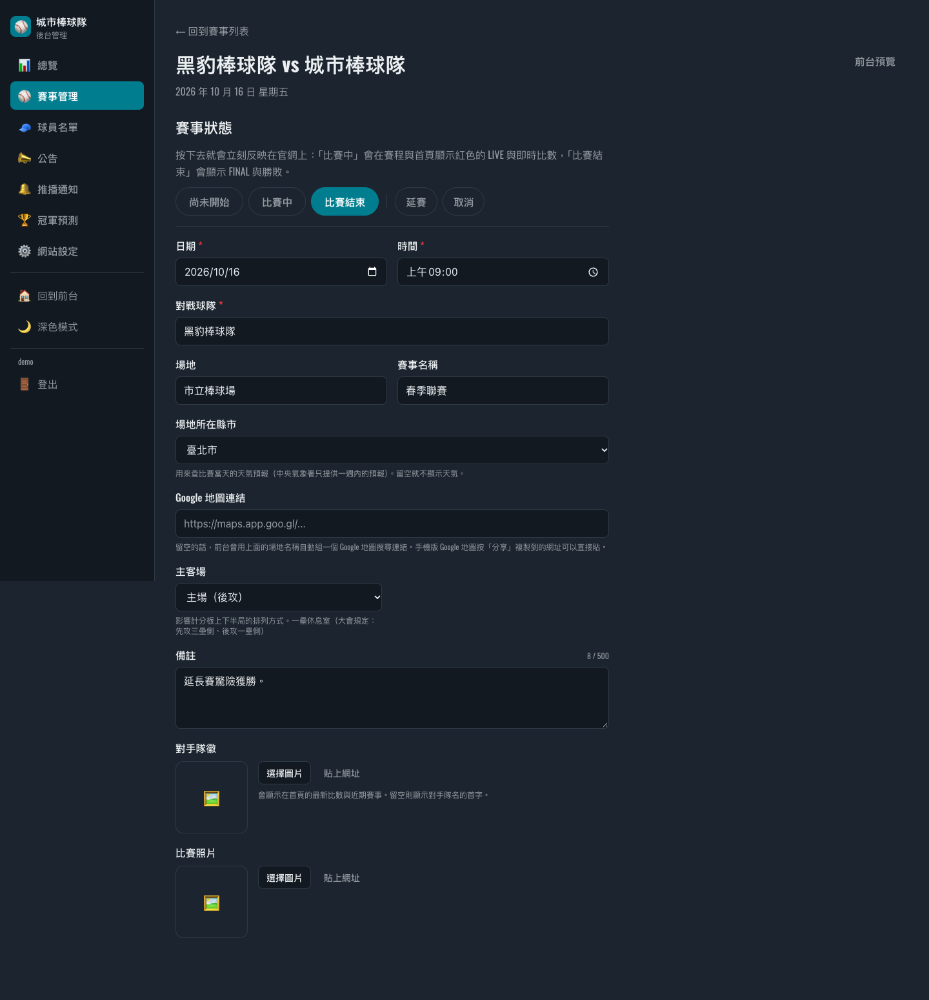

**賽事狀態排在所有欄位的最前面**，和其他欄位之間有一條分隔線：其餘欄位是建檔時
填一次就不再碰的，狀態是比賽當天要按兩次的按鈕 —— 混在表單中間的話，開賽前那
三十秒裡它會變成最難找的東西。

分頁列固定在畫面**底部**，因為每個分頁都很長而管理者是在分頁之間來回切的；
放在頂端等於每切一次都要先捲回最上面。

打線排好之後可以直接截一張出賽名單圖卡丟進群組。

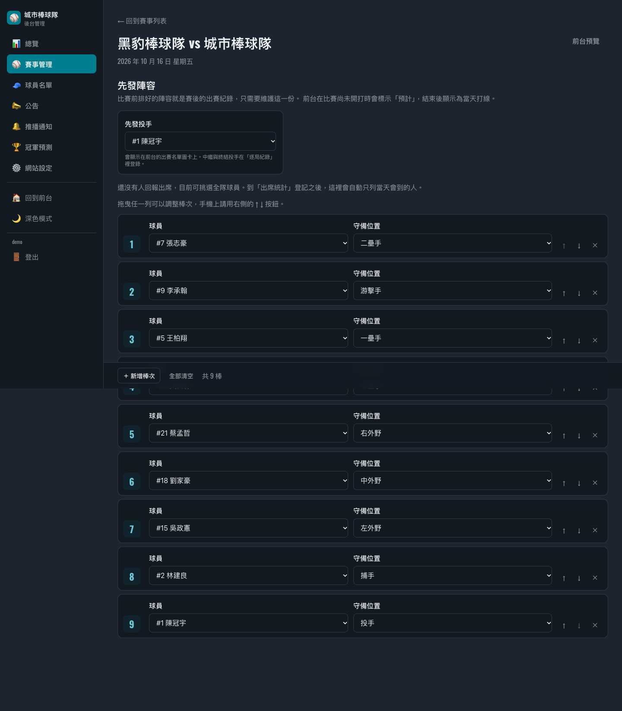

**名牌上只有「#背號 名字」。** 轉播圖卡上的打擊率、OPS 那些東西一概不放：這張卡是
**賽前**的名單，那時候還沒有任何打席可以推導成績，而名單會被截圖傳到群組，上面的
每個數字都會被當真 —— 憑空生一個 `AVG .342` 比留白糟糕得多。曾經放過三項「推導
得出來」的資訊（投打習慣、第四棒徽章、有沒有 DH），後來全部拿掉了：算得出來不等於
該放，一張要被快速掃過的名單上，每多一個標籤就讓名字少一分醒目。

---

## 場邊的那支手機：逐局逐打席

這是整個專案花最多力氣的地方。後台的「逐局紀錄」以半局為單位維護，每一筆就是
一個打席，由它往下推導出逐局得分、半局賽況與成績表。

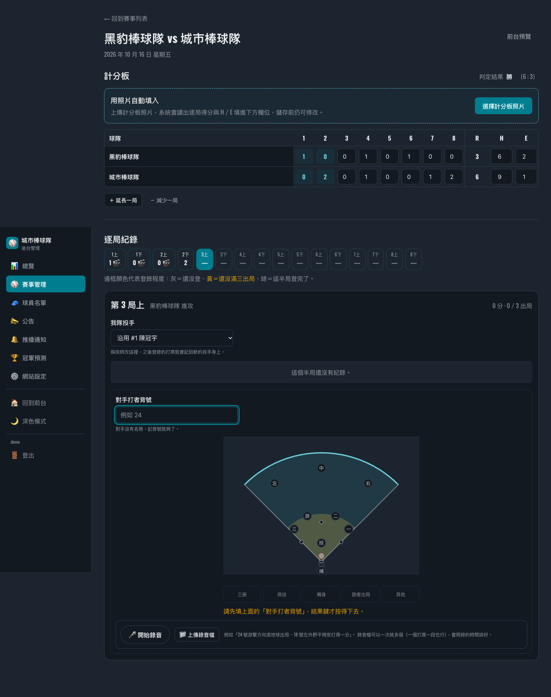

推導鏈是**單向**的，而且整條套在 repository 裡，所以不論從哪個入口寫入（後台表單、
AI 辨識、批次匯入、逐局紀錄頁）結果都一致：

```
逐打席 → 逐局得分 → R（總得分）
```

規則只有一句話：**一個半局只要有任何一筆打席，那一格就完全由打席加總決定；
沒有打席的半局才看手填的值。** 逐格判斷，所以同一格永遠只有一個來源。
被接管的那幾格在後台是唯讀的，並且標示來源 —— 一格數字改不動而畫面上又沒說原因，
看起來就是壞掉了。

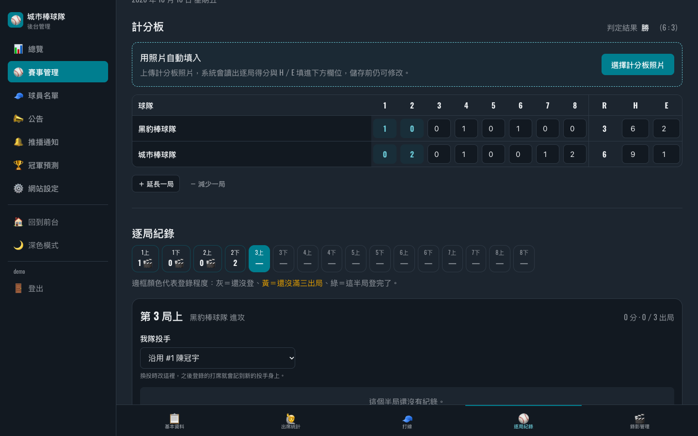

### 主要的輸入方式是拖曳

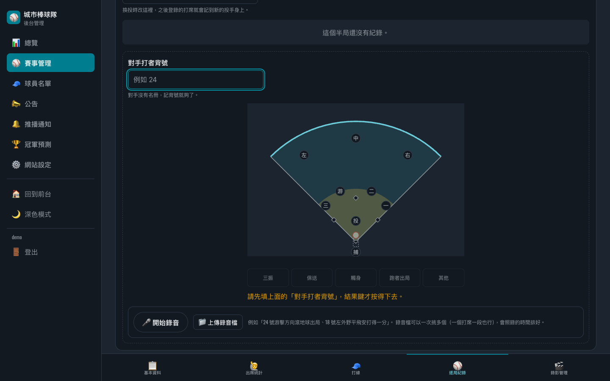

從本壘把球拖到落點，放開之後在選單上點結果，常見的情況是「拖一次、點一次」。
打者依打線自動帶下一棒，所以多數打席只要按一個鍵。

選單上的六顆按鈕排序是調過好幾次的：

- **一壘安打與二壘安打固定排前兩個，不管球落在哪裡。** 區域原本會決定第一顆
  （內野→滾地出局、外野→飛球出局），但那讓同一顆按鈕每次都在不同位置 ——
  場邊的人一邊看球一邊點，要的是「安打永遠在左上角」這種肌肉記憶，而不是每次
  重讀六顆按鈕。安打也是最不能點錯的那一種：點成出局，出局數、打擊率、完整性一起錯。
- **選單是排序不是過濾。** 牆外只有全壘打、界外只有界外飛球出局，其餘區域決定
  清單裡怎麼排。規則猜錯時正確的選項還在，只是要點「更多」；過濾掉的話就只能
  取消重拖。
- **安打的按鈕是實心的強調色，出局是線框。** 每顆按鈕的字數都差不多
  （「一壘安打」「滾地球出局」），全部長一樣的時候，場邊的人是在讀字而不是在認按鈕。

三出局之後整個半局鎖住（包含已登錄的打席 —— 場邊手一滑就會刪到上一局的紀錄），
登錄第三個出局會自動跳到下一個半局，而會讓出局數超過三的結果按不下去。

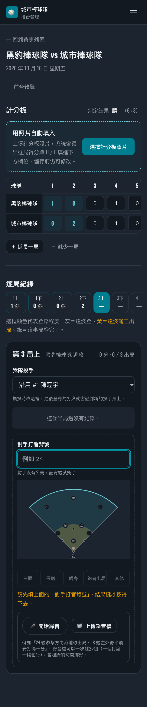

### 還有語音

一邊看球一邊打字不現實，所以可以直接講：「24 號游擊方向滾地球出局、18 號左外野
平飛安打得一分」，模型自己斷句，結果進暫存卡片讓人確認過才寫進半局。

**語音走的是錄音 → BFF → Gemini，不是瀏覽器內建的語音辨識** —— iOS 加到主畫面的
PWA 沒有 `SpeechRecognition`（API 偵測得到，但回呼永遠不會觸發，是一個 2021 年就
開著的 WebKit bug），而這個球隊的登錄裝置正是 iPhone 的主畫面 App。

人在場上打球時手機不在身邊，所以也可以事後上傳隨身錄音筆的檔案，走**完全同一條**
辨識路徑。一個半局十幾分鐘的錄音沒辦法整段送上去（16kHz 單聲道 WAV 每秒 32KB，
十分鐘 19MB，base64 之後 26MB），而固定長度切段會把「24 號三壘安打」切成兩半。
解法利用「登錄者是刻意唸出來的」這個前提：先挑出有人說話的片段、接起來、分組送，
**切點一律落在靜音處**。實測一個十分鐘的檔案裡有四句話，挑完只送了 12.6 秒的音訊，
一次呼叫就認出四個打席。

---

## AI 只負責讀，解讀規則寫在程式碼裡

一共六支辨識端點：賽程公告圖、計分板照片、Excel 球員名冊、LINE 出席投票截圖、
逐打席語音，以及反方向的那一支 —— 把登好的半局寫成一段話。

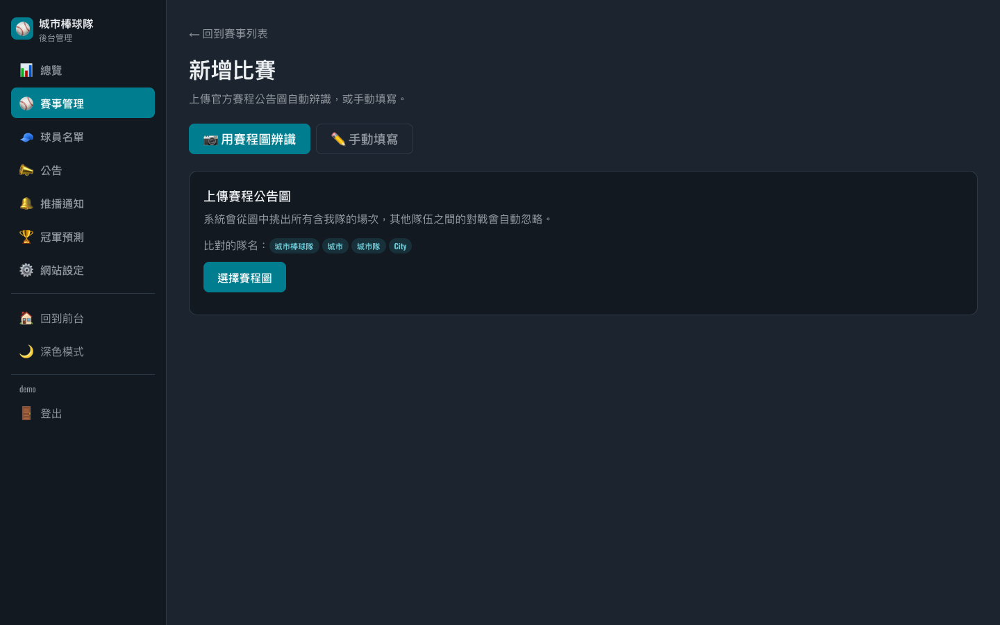

共同的設計：用結構化輸出強制 JSON（不解析散文）、**端點不寫入任何資料**（回傳的
是建議，一律先進後台表單讓人確認）、格式收斂（日期、守備位置、慣用手的各種寫法）
用程式碼處理而不是靠提示詞叮嚀 —— 因為程式碼測得到。

最能說明這條原則的是賽程辨識的主客場。這個球隊的慣例是「寫在前面的先攻」，所以
「後港傭兵 vs 兄弟象」＝後港先攻＝客場。原本是在提示詞裡叫模型自己判斷主客場，
那要它同時做兩件事，而第二件**是這支球隊的慣例而不是常識**（MLB 的「A vs B」
剛好相反）。猜錯的結果是整張賽程的主客場全部顛倒，連帶計分板的上下半局與前台的
排列全部跟著錯，而畫面上只是「看起來怪怪的」。現在模型只回「先攻是誰、後攻是誰」，
翻譯成主客場由一支純函式做，兩邊都像我隊或都不像時不猜，退回圖上明寫的值並補一則警告。

### 反方向的那一支：把半局寫成一段話

登完一個半局可以按一顆按鈕，產生一段像賽後簡報的短文，複製去貼群組或公告。

**這一支最大的風險是編造，而且編得很像真的。** 資料裡沒有跑者 —— 我們只知道
「這個打席隊伍得幾分」，不知道誰在幾壘、怎麼推進回來的。模型非常樂意補上
「一二壘有人」「滿壘危機」這種聽起來很專業的句子，而看的人分辨不出來。所以提示詞
把**不知道的事逐條列出來並禁止提及**（壘包狀況、球數球種球速、守備的精彩程度、
這個半局以外的事），而不是只說「不要編造」—— 泛泛的叮嚀擋不住，列出項目才擋得住。

產生的文字會存起來並顯示在前台，所以還有第二條規則：**打席一改，那一格的敘述
就直接刪掉**。留著就是對訪客說一件沒有發生過的事。寧可空白，也不要一段看起來
很專業但是錯的文字。

---

## 球賽錄影：每半局一段

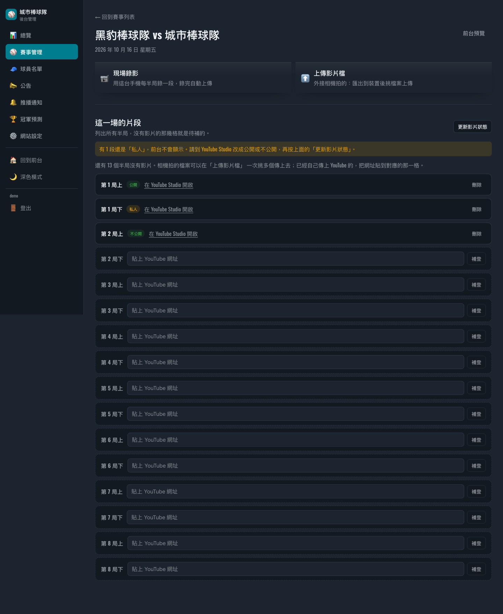

用手機瀏覽器原生的 `getUserMedia()` + `MediaRecorder` 每半局錄一段（攻守交換就是
天然的切點），錄完自動推進到下一個半局，上傳到 YouTube 之後掛回那一格。
前台一場最多十四段，預設只載縮圖，點了才換成播放器。

這一段的坑幾乎都是「只在真的裝置上才發生」的那一種：

- **錄影中的資料不能留在記憶體。** 原本每 5 秒一塊全留在陣列裡，在 iPhone 的 PWA
  錄到十分鐘左右 iOS 就把整個網頁程序殺掉 —— 畫面閃一下、整頁重新載入、再要一次
  相機權限，那一段就這樣消失（在球場真的發生過）。現在每一塊一到就寫進 IndexedDB，
  結束時再從磁碟組回來。
- **轉動手機不會讓已經取得的畫面跟著轉。** 直向開啟拿到的串流就是直的，轉成橫的
  之後它還是直的 —— 而預覽因為裁切看起來完全正常，錄出來卻是直式影片。解法是
  重新取得串流讓它以新方向協商，但**錄影中絕對不能重開**。
- **mp4 一定要排在 webm 前面。** Safari 只錄得出 mp4，Chrome 兩種都行；順序反過來
  Android 會錄成 webm，而 webm 在 iPhone 上完全播不動 —— 錄的人看不出異常，
  一半的家屬打開是黑的。
- **YouTube 頻道有「每天能上傳幾支」的額度**，和 API 配額是兩回事，撞到要等 24 小時。
  一場十四段很容易撞上，所以認出那個錯誤就整批停下，而不是讓七段各失敗七次。

上傳佇列活在 plugin 上而不是頁面上（一個檔案要傳幾十分鐘，中途切去看別的後台頁
是常態），斷點寫進 IndexedDB，所以重新整理也接得回來。

---

## 提醒是排程送的，不是計時器

賽前 3～7 天送一則出席提醒、賽前一天再送一則、出席回報截止的前一天再一則。

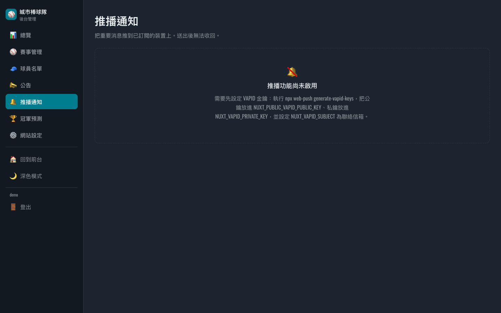

**容器沒人瀏覽時會整個關掉，所以程式裡的計時器一定行不通** —— `setInterval` 只在
「剛好有人正在看網站」時活著，而要發提醒的清晨正是最沒有人在看的時候。必須由外部
的排程服務每天叫一次端點。

時區是這個功能最容易錯的地方：伺服器跑在 UTC，台北時間 00:00–07:59 這八小時裡
它還停在前一天 —— 用當地時間算「今天」會讓所有提醒差一整天，而且**本機完全重現
不了**（本機就是台北時間）。

推播走標準 Web Push 而不是 FCM，因為 FCM 要在瀏覽器載入 Firebase SDK，那會推翻
最前面那條設計。

---

## 部署：冷啟動不靠付錢解決

跑在 Firebase App Hosting 上，`minInstances: 0` —— 沒人看的時候縮到零，冷啟動約 2.7 秒。
解法是 CDN：公開頁面帶 `s-maxage=60, stale-while-revalidate=600`，過期後 CDN 先送
舊的再背景更新，**冷啟動因此不在使用者的等待路徑上**。

代價是「同一份 HTML 送給所有人」，所以公開頁面的 SSR 輸出不能包含任何個人狀態：

- 配色偏好由 `<head>` 的開機腳本在瀏覽器端套用，SSR 不輸出深色的 class
- 登入狀態只在後台的 SSR 還原，公開頁面進瀏覽器之後才問「我是誰」
- **回應只要帶一個 `Set-Cookie`，CDN 就完全不快取**

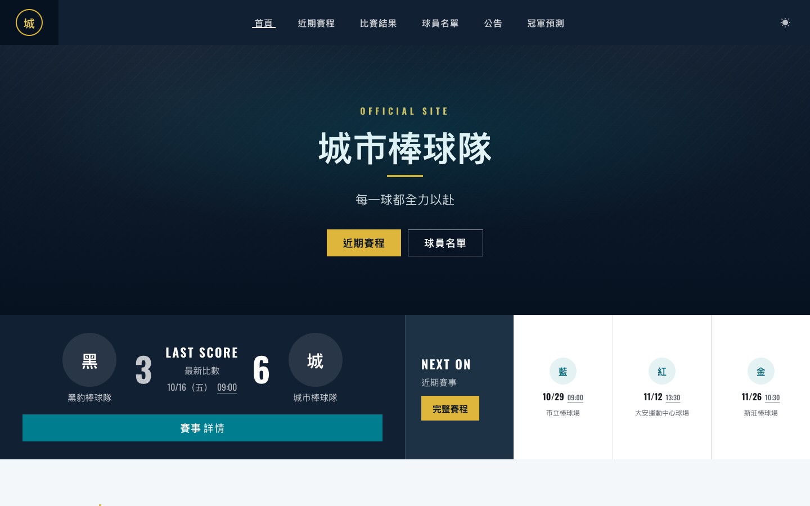

前台的單場比賽頁上有一個只給登入者看的「後台編輯這場」。它之所以安全，是因為
公開頁面的 SSR 一律渲染成未登入 —— 連結在 SSR 與 hydration 的第一幀都不存在。
**不要為了「少閃一下」而在 SSR 還原公開頁面的登入狀態**：那會讓管理者那一份 HTML
被快取起來送給所有訪客。端對端測試直接比對「帶 session cookie 與匿名的 SSR 輸出
一模一樣」，因為這類失效在畫面上完全看不出來。

---

## 技術棧

| 層   | 用什麼                                                           |
| ---- | ---------------------------------------------------------------- |
| 前端 | Nuxt 4 / Vue 3 / Tailwind 4 / Pinia                              |
| BFF  | Nitro（h3）、Zod、Pino                                           |
| 資料 | Firestore（打線、出席、計分板、打席都內嵌在比賽文件裡）、Storage |
| AI   | Gemini（結構化輸出）                                             |
| 影片 | YouTube Data API（瀏覽器直傳，BFF 只發短效權杖）                 |
| 推播 | 標準 Web Push（VAPID），手寫的 service worker                    |
| 測試 | Vitest：純邏輯 / 元件（happy-dom）/ 端對端（真實建置 + 伺服器）  |

打線、出席、計分板、逐打席全部**內嵌在比賽文件裡** —— 遠小於單一文件的大小上限，
而看一場比賽只要一次讀取。

---

## 幾條反覆出現的原則

寫到最後會發現，上面大部分的決定都是同幾條原則的不同長相：

1. **能推導的就不要存。** 勝敗、候補名單、休息室、總得分、出賽紀錄 —— 多存一份
   就多一個會不同步的東西，而不同步的那兩個畫面通常在不同頁面，沒有人會同時看到。
2. **端點不寫入，建議交給人確認。** 六支 AI 端點沒有一支會直接改資料。
3. **不確定就不要顯示。** 登錄不完整就不給打擊率，沒有跑者資料就不寫壘包狀況，
   名單圖卡上不放賽前算不出來的數字。
4. **規則寫在程式碼裡，不寫在提示詞裡。** 因為程式碼測得到。
5. **症狀在畫面上看不出來的錯誤最貴**，所以它們一條一條被寫成測試：主客場的翻譯、
   自動儲存的基準、CDN 不因人而異、計分板前後台排序一致、相機權限的那個標頭。

---

_這篇文章是活文件：產品改版後會原地更新，每次迭代另外發一篇短文說改了什麼、
為什麼那樣改。文章裡的每一張截圖都由 `pnpm screenshots` 重新產生，場景定義在
`scripts/screenshot-scenes.mjs`。_
